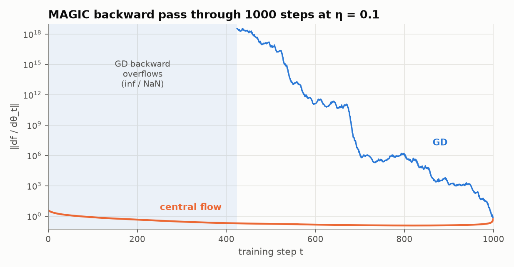
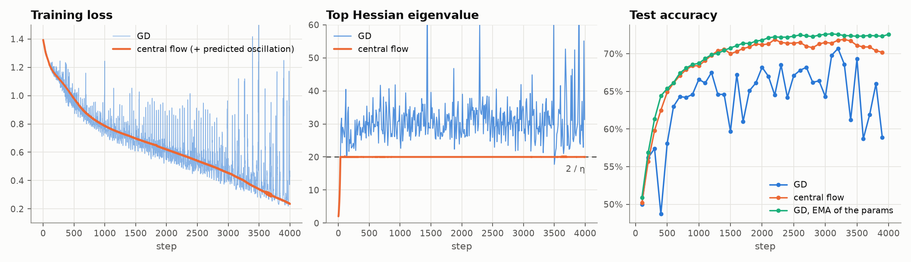
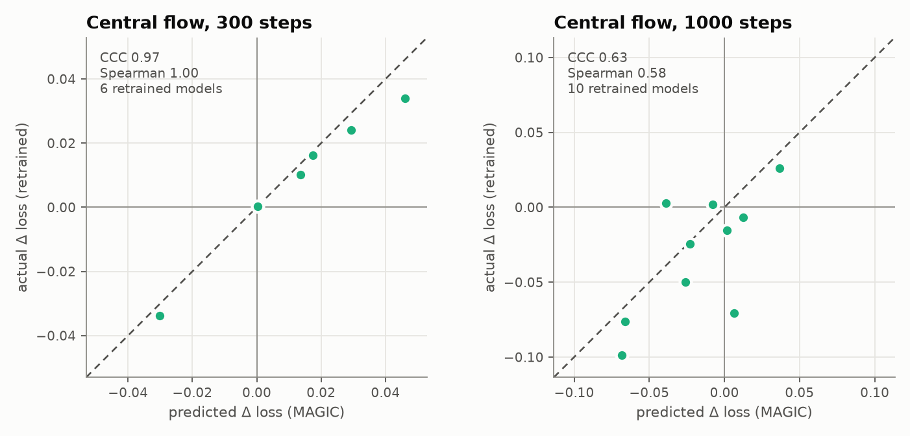

# MAGIC through the edge of stability

Data attribution with [MAGIC](https://arxiv.org/abs/2504.16430) (Ilyas & Engstrom, 2025): backpropagate an eval loss
$f$ through the whole training run to get the exact derivative $\partial f / \partial w$ with respect to per-example
training weights $w$. It predicts how $f$ changes when the training data is perturbed:

$$
f(w) - f(\mathbf 1) \approx \frac{\partial f}{\partial w} \cdot (w - \mathbf 1)
$$

At the [edge of stability](https://arxiv.org/abs/2103.00065), the backward pass through GD explodes. The
[central flow](https://arxiv.org/abs/2410.24206) (Cohen et al., 2024), a smooth model of GD's time-averaged
trajectory, can be differentiated stably instead.







*CNN (width 12) on 1024 CIFAR-10 images of 4 classes, full-batch, η = 0.1. Bottom: each point is a model retrained with
the training weights perturbed by N(0, 0.01), loss on one test example.*

## Quick start

Python 3.12+. Install the dependencies, then run everything from this directory with `PYTHONPATH=.`:

```bash
pip install -r requirements.txt
```

```bash
export PYTHONPATH=.
DIR=results/my_exp

python main.py new $DIR --dataset cifar10 --model cnn --width 12 --n-train 1024 --n-classes 4 \
    --batch-size 1024 --optimizer centralflow --lr 0.1 --n-steps 300
python main.py train   $DIR --checkpoint-every 50   # full model + logs (losses, eigenvalues, test metrics)
python main.py retrain $DIR --kind randn --alpha 0.01 --n-subsets 10   # ground truth: perturbed retrainings
python main.py magic   $DIR --n-test 1 --n-subsets 1   # df/dw for each eval set
python -m experiments.evaluate $DIR   # MAGIC vs. retrained scatter plots + results.json
```

Or run the whole pipeline (including learning-rate tuning if `--lr` was not given) with
`python -m experiments.sweep $DIR --kind drop --alphas 0.01,0.02,0.05 --n-train-subsets 10 --n-eval-subsets 5`.

`train` and `retrain` each need only `config.json`. `magic` needs `train`, and `evaluate` needs all three. Every
command skips work already saved in the directory and continues a killed run from its last checkpoint. `--device 8` spreads
the work across 8 GPUs.

## What's in an experiment directory

```
DIR/
├── config.json                 # dataset, model, optimizer, lr, steps (main.py new)
├── full_model/
│   ├── final.pt                # the trained state
│   ├── checkpoints/<t>.pt      # states MAGIC replays from (train --checkpoint-every)
│   └── metrics.pt, *.png       # training logs and their plots
├── retrained/<kind>_<alpha>_<i>/
│   ├── final.pt, perturbation.pt
│   └── losses.json
├── magic/<n>_examples_<i>/
│   └── linearization.pt        # eval indices, f, d_weights = df/dw [N]
└── evaluation/                 # scatter plots, results.json (CCC, Spearman, TLS slope)
```

Steps are counted in **optimizer steps**. Edge flow and central flow take `SUBSTEPS = 4` optimizer steps per config step,
so a central-flow run with `--n-steps 1000` has checkpoints numbered up to 4000. `main.py prune DIR` deletes the saved
states (`*.pt`) and keeps the logs, the influence scores and the cached losses.

## Optimizers

`--optimizer` picks one. Each one is a pure, differentiable state (`state.step(t, forward_fn)`) with an exact
vector-Jacobian product for MAGIC:

| name | what it is |
|---|---|
| `sgd`, `momentum`, `adam` | the usual first-order optimizers (full batch when `--batch-size` ≥ `--n-train`). They can train many retrained models at once with `vmap`. |
| `heun` | Heun's method (2-stage Runge–Kutta) on gradient flow |
| `sharpness` | GD with step size $\eta \cdot 2 / \text{sharpness}$ |
| `newton` | damped Newton, $(H + \text{shift}\, I)^{-1}$ times the gradient |
| `edgeflow` | Edge Flow: averages the gradient at $\theta \pm \epsilon\, v$ along the top eigenvector $v$, with $\epsilon$ growing while the sharpness exceeds $2/\eta$ |
| `centralflow` | the central flow: LOBPCG for the top Hessian eigenpairs every step, third derivatives and a small semidefinite complementarity problem once eigenvalues are critical. Its exact adjoint includes the eigenvectors' derivative (MINRES). |

## Code map

| file | contents |
|---|---|
| [main.py](main.py) | the CLI (`new`, `train`, `retrain`, `magic`, `prune`) and `Experiment`, which builds everything from `config.json` |
| [src/magic.py](src/magic.py) | `Magic`: the training loop, checkpoint replay, and the backward pass; `TrainLog`: training with logging, checkpoints and resume |
| [src/objective.py](src/objective.py) | the loss as a function of the params; Hessian-vector products; eval-set gradients |
| [src/optimizers.py](src/optimizers.py) | `OptimState` and the first-order optimizers, the learning-rate schedule |
| [src/second_order.py](src/second_order.py) | optimizers that use Hessians: `SharpnessState`, `NewtonState`, `EdgeFlowState`, `CentralFlowState` |
| [src/lobpcg.py](src/lobpcg.py), [src/minres.py](src/minres.py), [src/sdcp.py](src/sdcp.py) | eigensolver, linear solver, and the small dense complementarity solver (with its implicit derivative) |
| [src/models.py](src/models.py), [src/data.py](src/data.py) | μP models (MLP, CNN/ResNet, ViT); datasets (MNIST, CIFAR-10, a synthetic majority task), subsets and loaders |
| [experiments/](experiments/) | scripts that run on experiment directories: `evaluate`, `sweep`, `tune_lr`, `centralflow_vs_gd`, `edgeflow_vs_gd`, `drift`, `eig_tol`, `replot`, … |

## Tests

```bash
python -m pytest test/                                   # ~80 s on CPU
python -m pytest test/test_magic.py -k centralflow       # e.g. MAGIC through the central flow vs. finite differences
```

The tests check MAGIC against autograd through the whole training run (first-order optimizers, `sharpness`, `edgeflow`),
and against finite differences for the central flow. They also test the solvers and run the CLI end to end on tiny CPU configs.
